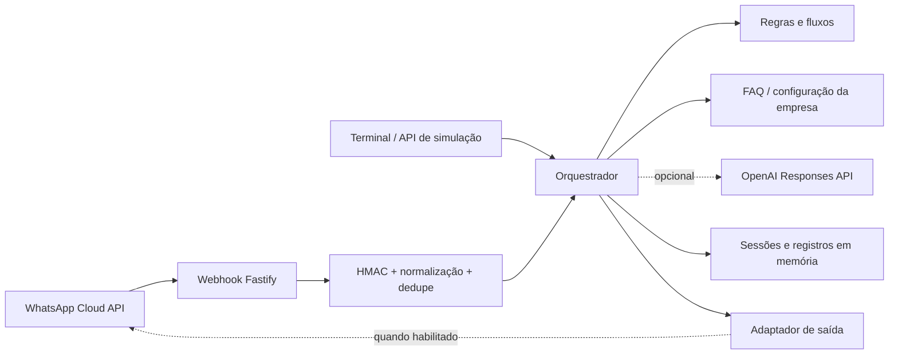

# Agente empresarial para WhatsApp

MVP configurável de atendimento em português brasileiro. Ele funciona imediatamente em modo determinístico, sem credenciais externas, e pode usar a OpenAI Responses API e a WhatsApp Cloud API quando as chaves forem adicionadas.

> Os dados da “Empresa Modelo” são fictícios. Eles estão centralizados em `config/company.example.json` para serem substituídos quando o contexto real estiver disponível.

## O que já funciona

- FAQ e apresentação da empresa a partir de JSON configurável;
- preços e serviços sem inventar descontos;
- captura de lead com consentimento e confirmação;
- solicitação de agendamento sem alegar que o horário foi confirmado;
- triagem de suporte com até duas orientações documentadas;
- handoff para humano com resumo e protocolo local;
- opt-out e reativação com confirmação;
- fallback progressivo e pausa após três falhas;
- proteção básica contra prompt injection, redação de segredos comuns e solicitações LGPD;
- simulador no terminal, por HTTP e em uma interface publicável no GitHub Pages;
- webhook da Meta com challenge, assinatura HMAC do corpo bruto, lote, status e deduplicação;
- fila por contato, cache de resposta e retry síncrono sem repetir o raciocínio do agente;
- envio opcional pela Graph API;
- testes unitários e de integração.

## Arquitetura



As fronteiras estão separadas para permitir trocar a memória por PostgreSQL/Redis, o protocolo local por CRM/help desk e o processamento em linha por uma fila durável.

```text
src/
├── application/       # orquestrador, fluxos, FAQ e portas
├── adapters/          # OpenAI e WhatsApp/Meta
├── config/            # validação de ambiente e base empresarial
├── domain/            # tipos e contratos de dados
├── http/              # rotas, raw body, HMAC e coordenação de envio
└── infrastructure/    # armazenamento/outbox em memória do MVP
```

## Brain e Obsidian

A pasta `brain/` é um vault Markdown compatível com Obsidian. Ela separa conteúdo compartilhado,
manifesto, conhecimento, fluxos e avaliações de cada agente. A primeira amostra é
`brain/agents/empresa-modelo/`; `brain/agents/_template/` serve como ponto de partida para novos
agentes.

Abra `brain/` como vault no Obsidian e comece por `brain/HOME.md`. Antes de publicar alterações:

```powershell
pnpm brain:validate
pnpm brain:publish --agent empresa-modelo --as-of 2026-07-12 --check
```

O validador verifica frontmatter, IDs duplicados, estados editoriais, links Obsidian, manifests e
padrões óbvios de segredos. O publicador compila somente notas `approved`, vigentes e com
sensibilidade autorizada em uma release JSON imutável, executa avaliações críticas e registra hashes.
O runtime ainda usa `config/company.example.json`; a etapa seguinte passará a exigir uma release
explicitamente selecionada.

Para publicar a amostra fictícia:

```powershell
pnpm brain:publish --agent empresa-modelo --as-of 2026-07-12
```

O comando não segue links Obsidian como dependências e recusa sobrescrever uma versão com bytes
diferentes. Incremente `version` no `agent.json` para uma nova publicação.

## Segurança do repositório público

Este repositório contém apenas código e dados fictícios de demonstração. Nunca commite conversas,
leads, dados pessoais, credenciais ou conhecimento real de clientes. Copie `.env.example` para `.env`
e mantenha todas as chaves somente no ambiente local ou no gerenciador de segredos do provedor.

Antes de cada push, execute:

```powershell
pnpm secrets:check
```

O comando verifica arquivos rastreados e o histórico Git por formatos conhecidos de credenciais. Ele
é uma proteção complementar: qualquer segredo exposto deve ser revogado imediatamente, mesmo que o
arquivo seja removido depois. Veja também [SECURITY.md](SECURITY.md).

## Início rápido

Pré-requisito: Node.js 22 ou mais recente e pnpm.

### Windows: abrir a interface com dois cliques

Execute [start-ui.cmd](start-ui.cmd). Ele prepara o projeto, abre o navegador e inicia a interface em `http://127.0.0.1:3000`. Mantenha a janela do servidor aberta enquanto testa.

Esse inicializador também funciona quando `pnpm` não está no PATH: se necessário, usa `npm.cmd` como alternativa.

### Terminal interativo

```powershell
Copy-Item .env.example .env
pnpm install
pnpm chat
```

Converse normalmente no terminal. Comandos úteis:

- `/reset`: limpa a conversa atual;
- `/estado`: mostra sessões, leads, agendamentos e tickets locais;
- `/exit`: encerra o simulador.

Teste sugerido:

```text
Oi
Qual é o horário de atendimento?
Quanto custa?
Quero contratar
```

## Servidor e simulador HTTP

```powershell
pnpm dev
```

Em outro terminal:

```powershell
Invoke-RestMethod -Uri http://127.0.0.1:3000/health

$body = @{
  userId = "cliente-teste"
  message = "Qual é o horário de atendimento?"
} | ConvertTo-Json
$utf8Body = [System.Text.Encoding]::UTF8.GetBytes($body)

Invoke-RestMethod `
  -Method Post `
  -Uri http://127.0.0.1:3000/api/simulate `
  -ContentType "application/json; charset=utf-8" `
  -Body $utf8Body
```

Principais endpoints:

| Método | Caminho | Uso |
|---|---|---|
| `GET` | `/health` | saúde e modo ativo |
| `POST` | `/api/simulate` | testa uma mensagem |
| `POST` | `/api/simulate/reset` | limpa a sessão do simulador |
| `GET` | `/api/debug/state` | inspeciona registros locais; desative em produção |
| `GET` | `/webhooks/whatsapp` | challenge de configuração da Meta |
| `POST` | `/webhooks/whatsapp` | mensagens e status do WhatsApp |

Em produção normal, os endpoints `/api/simulate*` e `/api/debug/state` não são registrados. O modo
isolado `DEMO_HOSTED=true` publica somente `/health` e `/api/simulate*`, exige token Bearer, restringe
CORS e aplica rate limit; nesse modo a interface local, o debug e os webhooks do WhatsApp ficam
desabilitados.

## Demo online: GitHub Pages + Render

O frontend estático fica no GitHub Pages e o backend Fastify fica em um Web Service do Render. Este
repositório mantém o código-fonte canônico em `public/` e o `render.yaml` do backend. A publicação do
Pages é feita pelo repositório separado
[`Movits/yolo-hub-agents-demo`](https://github.com/Movits/yolo-hub-agents-demo); o workflow de Pages
pertence a esse repositório de deploy, não ao `main` deste projeto.

1. Crie o serviço pelo Blueprint do Render e informe um `SIMULATOR_API_TOKEN` aleatório com pelo
   menos 32 caracteres.
2. No repositório de deploy, cadastre a URL final do Render na variável `BACKEND_URL`.
3. Execute o workflow do GitHub Pages no repositório de deploy.
4. Abra a página, informe o token temporário no diálogo **Backend** e use apenas dados fictícios.

O token nunca é incluído no artefato do Pages: ele permanece somente em `sessionStorage` durante a
aba atual. A demonstração online usa memória efêmera, não habilita o webhook da Meta e não é um
ambiente de produção para clientes reais. No plano gratuito do Render, o primeiro acesso após um
período ocioso pode levar cerca de um minuto enquanto o serviço é reativado.

## Personalizar a empresa

1. Duplique `config/company.example.json` como `config/company.json`.
2. Troque empresa, serviços, políticas, FAQs e procedimentos de suporte.
3. Aponte `COMPANY_CONFIG_PATH=./config/company.json` no `.env`.
4. Mantenha respostas factuais e procedimentos seguros; não coloque segredos no JSON.
5. Quando houver integrações reais, troque `prototype` para `false` somente depois de conectar CRM, agenda e atendimento humano.

Não é necessário “treinar” um modelo para a primeira versão. Alimentar e revisar a base de conhecimento costuma ser mais rápido, barato e controlável. Fine-tuning pode ser avaliado depois, com conversas reais anonimizadas e um conjunto de testes.

## Habilitar a OpenAI

Adicione ao `.env`:

```env
OPENAI_API_KEY=...
OPENAI_MODEL=gpt-5.4-mini
```

A integração usa a Responses API com saída estruturada. A IA só é chamada quando regras e FAQs não resolvem a pergunta. Sem chave, o agente continua funcional em modo determinístico. O modelo fica configurável para que custo, latência e qualidade possam ser avaliados sem alteração de código.

Referências oficiais: [geração de texto com Responses API](https://developers.openai.com/api/docs/guides/text) e [Structured Outputs](https://developers.openai.com/api/docs/guides/structured-outputs).

## Conectar ao WhatsApp

O passo a passo detalhado está em [docs/META_SETUP.md](docs/META_SETUP.md). Em resumo:

1. Configure um app da Meta e uma WABA.
2. Crie um token de System User e guarde-o como segredo.
3. Exponha este servidor em HTTPS público.
4. Cadastre `https://SEU_DOMINIO/webhooks/whatsapp` como callback.
5. Preencha as variáveis `META_*` e `WHATSAPP_*`.
6. Ative `WHATSAPP_SEND_ENABLED=true` e `REQUIRE_WEBHOOK_SIGNATURE=true`.

## Verificação

```powershell
pnpm typecheck
pnpm test
pnpm build
```

Consulte [docs/TESTING.md](docs/TESTING.md) para o roteiro funcional e [docs/PRODUCTION.md](docs/PRODUCTION.md) antes de usar com clientes reais.

## Limites deliberados deste MVP

- sessões e registros somem ao reiniciar;
- não há CRM, calendário, help desk ou atendente conectados;
- o modo assíncrono usa apenas a memória do processo, não uma fila durável;
- mídia não é transcrita ou analisada;
- templates fora da janela de 24 horas não são enviados;
- não há painel administrativo nem métricas de produção; a demo hospedada usa apenas token Bearer e
  rate limit básico, não autenticação individual de usuários.

Esses limites estão explícitos nas mensagens do modo `prototype`, evitando que um teste pareça uma ação real.
