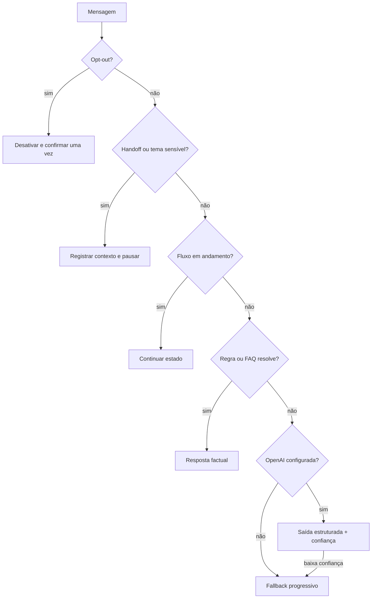

# Fluxos conversacionais

## Princípios

- A assistente se identifica como virtual.
- Respostas empresariais vêm apenas da configuração aprovada.
- Uma pergunta é feita por vez durante coleta.
- Preço, desconto, disponibilidade, status e protocolo nunca são inventados.
- Senha, token, código por SMS, CVV e cartão completo nunca são solicitados.
- Ações só são declaradas após o armazenamento ou integração confirmar sucesso.
- Pedido de humano, tema sensível, reclamação grave ou três fallbacks pausam a automação.

## Roteamento



## Lead

```text
interesse
→ consentimento de uso dos dados
→ nome
→ empresa ou “não se aplica”
→ necessidade
→ melhor período
→ resumo
→ confirmação
→ registro com protocolo
```

Se o consentimento for recusado, nenhum lead é criado e o agente continua respondendo dúvidas gerais.

## Agendamento

```text
intenção de agendar
→ serviço/assunto
→ preferência de data e horário
→ fuso explícito
→ resumo e confirmação
→ pedido pendente de confirmação humana
```

O MVP não usa calendário. Por isso a resposta diz “preferência registrada” e nunca “agendamento confirmado”.

## Suporte

```text
descrição segura
→ localizar procedimento aprovado
→ orientação 1
→ verificar resultado
→ orientação 2, quando houver
→ verificar resultado
→ ticket/handoff se não resolveu
```

Sem procedimento documentado, o fluxo não improvisa e encaminha. Fraude, cobrança sensível, risco de segurança, jurídico e privacidade vão direto para humano.

## Opt-out

`PARAR`, `SAIR`, `STOP`, `REMOVER` e frases equivalentes desativam novas respostas. O agente envia uma única confirmação. `VOLTAR` inicia confirmação; apenas `SIM` reativa.

## Estados de sessão

| Estado | Comportamento |
|---|---|
| `active` | regras, FAQs, fluxos e IA opcional ativos |
| `human_handoff` | automação silenciosa até reset ou conclusão externa |
| `opted_out` | silêncio, exceto fluxo explícito de reativação |

Os passos de coleta ficam em `flow` e os valores temporários em `flowData`. O histórico é limitado às últimas 20 mensagens no MVP.
